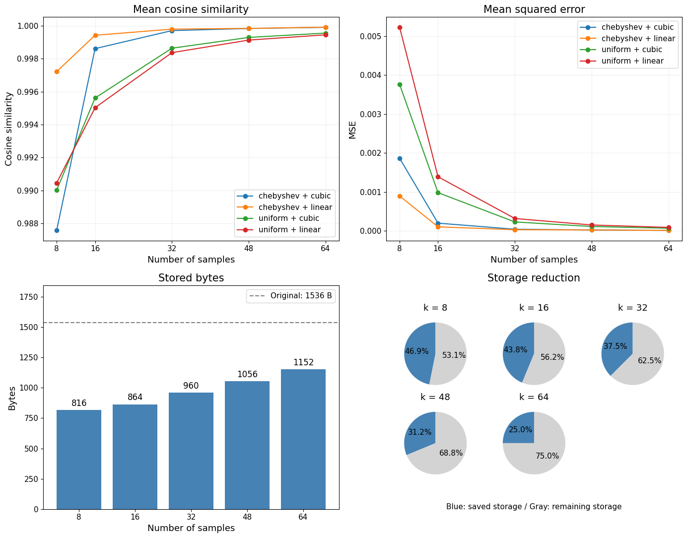
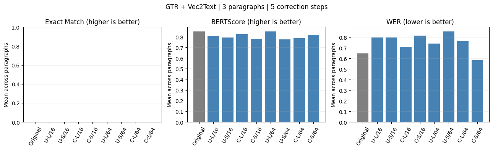

# Vector Interpolation

수치해석 과목의 임베딩 압축 및 보간 복원 실험입니다. 임베딩 값을 정렬하고 일부 좌표만 선택한 뒤, 보간으로 전체 벡터를 복원합니다. 벡터가 얼마나 비슷하게 복원되는지와 실제 텍스트까지 복원할 수 있는지를 별도로 비교합니다.

```text
텍스트 → 임베딩 → 오름차순 정렬 → 샘플링 → 보간 → 역정렬 → 평가
                                                       └→ Vec2Text → 문단 평가 (GTR)
```

## 노트북

| 파일 | 내용 | Colab |
|---|---|---|
| [embedding_interpolation_simple.ipynb](embedding_interpolation_simple.ipynb) | Paraphrase 임베딩 복원: 한국어 10문장 + 영어 10문장 | [실행하기](https://colab.research.google.com/github/OverWindow/Vector_Interpolation/blob/main/embedding_interpolation_simple.ipynb) |
| [vec2text_simple.ipynb](vec2text_simple.ipynb) | GTR + Vec2Text 문단 복원: 짧은 영어 문단 3개 | [실행하기](https://colab.research.google.com/github/OverWindow/Vector_Interpolation/blob/main/vec2text_simple.ipynb) |
| [embedding_interpolation_GPT_FULL.ipynb](embedding_interpolation_GPT_FULL.ipynb) | 100문장 확장 실험, 추가 오차 지표·보간 진단·직렬화 검증 | [실행하기](https://colab.research.google.com/github/OverWindow/Vector_Interpolation/blob/main/embedding_interpolation_GPT_FULL.ipynb) |

각 노트북에 입력 데이터가 포함되어 있으므로 별도 데이터 파일은 필요하지 않습니다. 처음 실행할 때 패키지와 모델을 다운로드하기 위한 인터넷 연결이 필요합니다.

## Colab 실행 방법

### 실험 1: Paraphrase 임베딩

1. `embedding_interpolation_simple.ipynb`를 Colab에서 엽니다.
2. 맨 위 패키지 설치 셀부터 `10. 결과 읽기`까지 순서대로 실행합니다. 이 실험은 CPU에서도 실행할 수 있습니다.
3. `SAMPLE_COUNTS`로 샘플 수를 조절합니다. 기본값은 `[8, 16, 32, 48, 64]`입니다.
4. CSV와 그래프는 `results_simple/`에 저장됩니다.

모델은 `sentence-transformers/paraphrase-multilingual-MiniLM-L12-v2`이며, 임베딩은 384차원입니다. `USE_SYNTHETIC = True`는 난수로 수치 코드만 확인하는 옵션입니다. 합성 데이터 결과를 문장 임베딩 성능으로 해석하지 않습니다.

노트북 끝의 `11. Vec2Text 모델을 이용한 실제 문장 유사도 테스트`는 이전에 추가한 별도 테스트입니다. GPU가 없어서 중단된 실행 출력이 남아 있습니다. 두 번째 실험은 아래의 독립된 `vec2text_simple.ipynb`에서 실행합니다.

### 실험 2: GTR + Vec2Text

1. 새 Colab 세션에서 `vec2text_simple.ipynb`를 엽니다. GPU 런타임을 권장합니다.
2. **맨 위 설치 셀만 먼저 실행합니다.**
3. **런타임 → 세션 다시 시작**을 선택합니다.
4. **설치 셀은 건너뛰고 `2. 설정`부터 차례로 실행합니다.** 설치 셀을 포함한 전체 실행은 하지 않습니다.
5. `SELECTED_PARAGRAPH`을 0, 1, 2로 바꾸어 원문과 복원문을 직접 확인합니다.

노트북에는 `vec2text==0.0.13`, `transformers==4.49.0`, `sentence-transformers==3.4.1` 등의 설치 설정이 있습니다. 설치 후 세션을 다시 시작해야 메모리에 남은 이전 라이브러리와 새 버전이 섞이는 문제를 피할 수 있습니다. 설치 목록의 sentence-transformers는 Vec2Text 의존성이며, 이 실험의 임베딩은 Vec2Text에 포함된 GTR 인코더로 생성합니다.

기본 설정은 `SAMPLE_COUNTS = [16, 64]`, `NUM_STEPS = 5`입니다. 입력은 각 3문장으로 구성된 영어 문단이며, 문단 전체를 하나의 768차원 임베딩으로 변환합니다. 현재 노트북은 짧은 입력 조건에 맞춰 GTR 토크나이저 기준 32토큰 이하인지 검사하며, 긴 문단을 자동으로 자르지 않습니다.

실행 후 `results_vec2text_paragraphs/`에 결과 CSV와 그래프가 생성됩니다. 저장소에 포함된 GTR 결과는 노트북의 실행 출력에서도 확인할 수 있습니다. Vec2Text는 Linux용 모듈을 사용하므로 Colab 또는 Linux에서 실행합니다. Linux CPU 실행도 가능하지만 문단 복원에 시간이 걸립니다.

### 확장 실험

`embedding_interpolation_GPT_FULL.ipynb`는 첫 Markdown 셀의 패키지 설치 안내를 따른 뒤 순서대로 실행합니다. 실제 데이터 결과는 `results/`, 합성 테스트 결과는 `results/synthetic/`에 저장됩니다. 간단 버전과 표본 수 및 저장 비용 계산 방식이 다르므로 결과를 구분해서 사용합니다.

## 비교 방법과 지표

- 샘플링: Uniform, Chebyshev-Lobatto. 정수 좌표로 반올림한 뒤 중복을 제거하고 부족한 점을 보충합니다.
- 보간: Linear, 자연 경계조건의 Cubic Spline.
- Paraphrase 대조군: 정렬하지 않고 Uniform + Linear 적용.
- GTR 기준 `Original`: 압축하지 않은 GTR 임베딩을 Vec2Text로 복원한 결과. 원문을 그대로 출력한 값이 아닙니다.

| 지표 | 평가 대상 | 해석 |
|---|---|---|
| 코사인 유사도 | 원본·복원 벡터 | 높을수록 방향이 유사함 |
| MSE | 원본·복원 벡터 | 낮을수록 좌표값 오차가 작음 |
| Exact Match | 원문·복원 문단 | 공백·대소문자·구두점까지 같으면 1, 아니면 0 |
| BERTScore F1 | 원문·복원 문단 | 높을수록 문맥 기반 토큰 표현이 유사함. 평가 모델은 `bert-base-uncased` |
| WER | 원문·복원 문단 | 단어 대체·삭제·삽입 수를 원문 단어 수로 나눈 값. 낮을수록 좋으며 1을 넘을 수 있음 |
| 저장량 감소율 | 임베딩 저장 비용 | 높을수록 원본 대비 저장량이 감소함 |

간단 버전의 조건별 점수는 입력별 점수의 단순평균입니다. WER에서도 대소문자와 구두점을 제거하지 않습니다.

### 저장 비용

간단 버전은 `float32` 샘플 값, 샘플 위치 인덱스, 원래 순서를 복원하는 순열의 배열 크기를 합산합니다. 임베딩 차원이 D, 샘플 수가 k, 인덱스 하나가 b바이트일 때:

```text
원본 저장량 = 4D
정렬 기반 압축 저장량 = 4k + bk + bD
저장량 감소율(%) = 100 × (1 − 압축 저장량 / 원본 저장량)
```

정렬하지 않은 대조군은 순열 비용 bD를 제외합니다. 파일 헤더나 모델 가중치는 간단 버전의 계산에 포함하지 않습니다. 확장 버전은 16바이트 헤더까지 포함한 직렬화 길이를 계산합니다. 샘플 개수 감소율과 실제 저장량 감소율은 다릅니다.

## 저장된 실험 결과

아래 수치는 두 간단 버전 노트북에 저장된 실행 출력 기준입니다. 재실행 환경과 라이브러리 버전에 따라 결과가 달라질 수 있습니다. `results_simple/results.csv`에는 k=8, 32, 64의 이전 실행 결과가 있으며, 노트북 출력에는 k=16, 48도 포함되어 있습니다.

### Paraphrase



20문장 실험의 노트북 실행 출력입니다. 위쪽은 방법별 복원 정확도, 아래쪽은 샘플 수별 저장 비용입니다. 원그래프의 파란색은 줄어든 저장량, 회색은 남은 저장량을 나타냅니다. 같은 샘플 수에서는 네 방법의 저장 비용이 같습니다.

Chebyshev + Linear는 시험한 모든 샘플 수에서 가장 높은 평균 코사인 유사도와 가장 낮은 평균 MSE를 보였습니다.

| 조건 | 샘플 수 | 코사인 유사도 | MSE | 저장량 감소율 |
|---|---:|---:|---:|---:|
| Chebyshev + Linear | 8 | 0.997215 | 0.000898 | 46.875% |
| Chebyshev + Linear | 32 | 0.999791 | 0.0000313 | 37.500% |
| Chebyshev + Linear | 64 | 0.999909 | 0.0000131 | 25.000% |

평균 코사인 유사도 0.95 이상을 유지하면서 저장량을 최소화하는 기준에서는 Chebyshev + Linear, k=8이 선택되었습니다. 원본 1,536 B를 816 B로 줄였습니다. 샘플 수를 늘리면 벡터 복원 정확도는 높아졌지만 저장량 감소율은 낮아졌습니다.

### GTR + Vec2Text



영어 문단 3개를 5회 반복 수정하여 복원한 결과입니다. 회색 막대는 압축하지 않은 `Original` 기준입니다. Exact Match는 모든 조건에서 0이므로 막대가 보이지 않습니다. U는 Uniform, C는 Chebyshev, L은 Linear, S는 Cubic Spline이며, 뒤의 숫자는 샘플 수입니다.

| 조건 | 샘플 수 | Exact Match | BERTScore F1 | WER | 저장량 감소율 |
|---|---:|---:|---:|---:|---:|
| Original | — | 0 | 0.8486 | 0.6481 | 0% |
| Uniform + Linear | 16 | 0 | 0.8084 | 0.7963 | 46.875% |
| Uniform + Cubic | 16 | 0 | 0.7931 | 0.7982 | 46.875% |
| Chebyshev + Linear | 16 | 0 | 0.8245 | 0.7076 | 46.875% |
| Chebyshev + Cubic | 16 | 0 | 0.7788 | 0.8148 | 46.875% |
| Uniform + Linear | 64 | 0 | 0.8492 | 0.7398 | 37.500% |
| Uniform + Cubic | 64 | 0 | 0.7760 | 0.8528 | 37.500% |
| Chebyshev + Linear | 64 | 0 | 0.7860 | 0.7622 | 37.500% |
| Chebyshev + Cubic | 64 | 0 | 0.8195 | 0.5809 | 37.500% |

샘플 16개에서는 Chebyshev + Linear가 두 텍스트 유사도·오류 지표에서 가장 좋았습니다. 64개에서는 Uniform + Linear의 BERTScore가 가장 높고, Chebyshev + Cubic의 WER이 가장 낮았습니다. 압축하지 않은 기준을 포함해 Exact Match는 모두 0이었으며, 샘플 수 증가가 텍스트 품질 향상을 보장하지 않았습니다.

## 해석 범위

벡터가 수치적으로 유사하더라도 원문의 표현이나 사실관계가 완전히 복원되는 것은 아닙니다. BERTScore가 높거나 WER이 낮아도 실제 복원문을 함께 읽어야 합니다. 두 실험은 모델과 입력 데이터가 다르고, 특히 GTR 실험은 영어 문단 3개만 사용하므로 일반적인 성능이나 통계적 유의성을 주장하지 않습니다.

가상환경, 다운로드한 모델, 임베딩 캐시 및 `.env`는 `.gitignore`로 제외합니다. 노트북과 작은 결과 CSV·그림·직렬화 예시는 저장소에 포함합니다. Colab에서 생성한 파일은 세션 종료 전에 내려받아 보관하세요.
